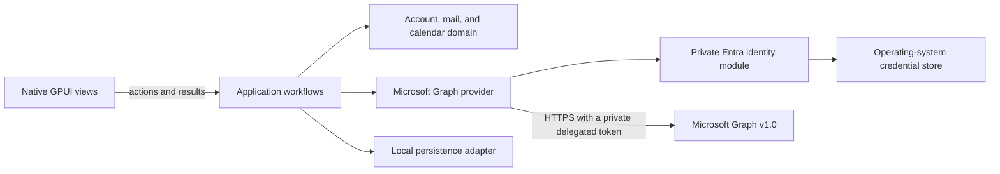

# System architecture

## Runtime shape

The app uses GPUI Kit for its native desktop UI. Rust owns the application, provider access, persistence, synchronization, and operating-system integration. The app does not use the Tauri runtime or a browser frontend.

The Linux account path includes connection, identity display, and permission renewal. The GPUI account view calls a single-account application workflow, which coordinates cancellation against credential commits through an application-owned operation handle. The Microsoft Graph provider performs OAuth authorization, Graph profile lookup, and Linux Secret Service refresh-token storage. Permission renewal requests only the M1 `User.Read` and `offline_access` scopes and verifies that the returned profile matches the active account. Mail, calendar, and production persistence workflows remain outside this candidate.

## Module ownership

| Path | Owns | Must not own |
| --- | --- | --- |
| `apps/desktop/` | GPUI lifecycle, native views, keyboard actions, OS integration, and native rendering of `SanitizedEmailHtml` | Mail rules, Graph request construction, database schema |
| `crates/application/` | The single-account workflow, provider ports, application errors, and cancellation ordering across credential persistence | GPUI, Graph JSON, concrete database types |
| `crates/domain/` | Provider-independent account profile and identifier types | Framework and provider details |
| `crates/providers/microsoft-graph/` | Linux Entra OAuth flow, Graph `/me` request and profile mapping, refresh-token storage, and the private HTTP client boundary | UI decisions, persistence policy, and token access in application code |
| `crates/persistence/` (planned) | Local schema, migrations, transactions, durable sync state | Graph or GPUI types |

Mail and calendar Graph operations, persistence, and synchronization remain planned. Update [project status](../project/status.md) when implementation changes.

Add planned crates when a change needs them. Do not create forwarding-only layers.

## Data flow

1. The GPUI account view calls the application workflow and owns the visible progress and cancellation states.
2. The workflow reserves the account operation and passes an application-owned cancellation handle through the provider port.
3. The provider opens the system browser and handles the OAuth callback and token exchange.
4. The provider requests Graph `/me`, validates the response, and maps it to an account profile. Permission renewal also checks that the returned account matches the active account.
5. The application handle atomically orders cancellation against refresh-credential persistence. Cancellation before commit leaves the prior credential unchanged; a commit that starts first returns its actual result to the view.
6. The provider stores the refresh token in Linux Secret Service, and the view displays the profile and user-safe errors.

OAuth tokens do not cross application ports. Views never receive tokens, call Graph, access identity state, or open the local database. The provider keeps OAuth and Graph code inside `crates/providers/microsoft-graph/`; see [ADR 0008](../decisions/0008-identity-token-boundary.md).

Domain entity IDs are opaque provider values and are always scoped by account. Preserve their exact case and contents. The Graph adapter requests immutable Outlook item IDs where supported; see [ADR 0009](../decisions/0009-account-scoped-domain-identifiers.md).

## Synchronization rules

- Use Microsoft Graph v1.0 delta queries for mail folders and calendar views where supported.
- Treat `@odata.nextLink` and `@odata.deltaLink` as opaque provider values. Follow the complete next-link chain before advancing a sync cursor.
- Before sending a bearer token to a next link, verify HTTPS and the configured Graph authority. Disable redirects for authorized Graph requests.
- Follow [ADR 0004](../decisions/0004-local-data-and-sync.md) for atomic page checkpoints, final delta-link commits, and one active sync round per cursor scope.
- Keep cursor state scoped to the account and the exact Graph collection or calendar-view range that created it.
- Use an outbox for local actions that may retry. Give each action a stable local identity and represent pending, confirmed, and failed states explicitly.
- Respect Graph throttling and retry guidance. Do not loop on authorization or validation failures.
- Honor Graph's `Retry-After` header after HTTP 429. Use exponential backoff only when the response has no retry header. Do not retry a write until duplicate-request behavior is known.

These are design constraints, not implemented behavior yet.

## Security boundaries

- Parse Graph responses, configuration, and stored data at their boundaries.
- Treat message HTML as untrusted input. The application must sanitize it with a maintained library before it reaches a view, and expose only `SanitizedEmailHtml` to the desktop. Never persist the sanitized result.
- ADR 0007 accepts GPUI Kit `TextView::html` as the Linux first renderer. Keep scripts, styles, images, and other remote content blocked by default; override link routing and image resolution as defense in depth. Production integration waits for the cached-message workflow and issue #9's remaining evidence.
- Keep the app UI in GPUI. A browser renderer for email HTML needs a separate security decision and must be limited to the message body. Give message content no application commands, tokens, IPC bridge, or access to mailbox data.
- Store refresh credentials in the operating-system credential store. Do not persist access tokens in SQLite or UI state.
- Decide local database encryption and key recovery before the app stores real mailbox content.

## Design risks

- Microsoft Graph does not support Exchange Server installed on premises. Supporting it needs a separate provider design.
- Microsoft does not list an official Rust MSAL implementation in its desktop app library table. The Linux implementation uses Huskarl with the system browser, but callback registration, browser behavior, MFA, Conditional Access, refresh, consent revocation, and sign-out still need live Entra evidence under issue #3.
- GPUI Kit is pre-1.0. Keep its resolved dependency graph in `Cargo.lock` and check the app on each supported platform.
- GPUI Kit's optional WebView package is experimental. Linux embedding requires X11 or XWayland, not Wayland. Windows WebView bounds cover GPUI overlays. It is not part of the accepted first message renderer; see [ADR 0007](../decisions/0007-message-body-rendering.md).
- Delta sync, recurring events, shared mailboxes, attachments, and calendar time zones have provider-specific behavior. Add a focused contract check for each supported behavior.
- The proposed Graph transport is `reqwest`, but its async client requires Tokio while the current GPUI dependency graph uses `smol`. Keep that runtime boundary inside the provider and prove it before adding the dependency.
- The current `io-msgraph` release includes calendar calls in its changelog, but its published README is stale and its error type drops `Retry-After`. See [ADR 0006](../decisions/0006-graph-http-transport.md) for the candidate review.
