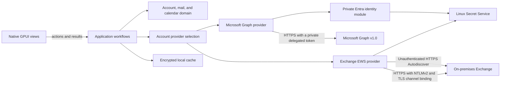

# System architecture

## Runtime shape

The application uses GPUI Kit for its native interface. Rust owns the UI, mail and calendar workflows, provider access, persistence, synchronization, and Linux operating-system integration.

PR #47 merged M2 read-only mail into `main`. PR #50 merged the Linux read-only calendar agenda and its reviewed M4 action stack into `main` on 2026-11-06.

M4 mail actions include read-state updates, follow-up flags, plain-text sends and replies, message moves, Archive, and Delete. Event actions include creating, editing, and deleting supported timed appointments. Archive moves mail to the default Outlook Archive folder. Delete moves mail to recoverable Deleted Items.

ADR 0058 records per-operation mail capabilities for M9. EWS exposes only message read-state changes, and only when its authenticated response provides a qualifying Exchange product version. Unknown or older versions stay read-only. The implementation is tracked in issue [#267](https://github.com/1fach/einfach-mail/issues/267); live Exchange behavior remains unverified under issue #257.

ADRs [0015](../decisions/0015-idempotent-message-read-state-update.md), [0017](../decisions/0017-safe-plain-text-mail-sending.md), [0018](../decisions/0018-native-plain-text-message-reply.md), [0019](../decisions/0019-follow-up-flags-on-cached-messages.md), [0020](../decisions/0020-move-cached-messages-between-folders.md), [0039](../decisions/0039-move-messages-to-deleted-items.md), and [0040](../decisions/0040-move-messages-to-the-default-archive-folder.md) record these actions.

[PR #51](https://github.com/1fach/einfach-mail/pull/51) merged issue #49 calendar cursor recovery into `main` after PRs #47 and #50. Its accepted design is in [ADR 0036](../decisions/0036-recover-expired-calendar-delta-cursors.md). Live reset-response behavior remains unverified until a Microsoft 365 tenant is available.

## Module ownership

| Target path | Owns | Must not own |
| --- | --- | --- |
| `apps/desktop/src/{app,platform,components,features/{account,mail,calendar},test_support}/` | GPUI lifecycle and shell, native feature views and actions, reusable GPUI widgets, Linux integration, and sanitized email rendering | Mail rules, Graph requests, database schema |
| `crates/application/src/{account,mail,calendar,shared}/` | Account, mail, and calendar workflows and their provider/cache ports; shared workflow reservations and recovery | GPUI, Graph JSON, concrete database types |
| `crates/domain/src/{account,mail,calendar,shared}/` | Provider-independent account, folder, message, calendar occurrence, and sync invariants | Framework and provider details |
| `crates/providers/account-router/src/lib.rs` | Selects the one saved account provider and enforces its declared account capabilities | EWS or Graph protocol details, UI state |
| `crates/providers/microsoft-graph/src/{config.rs,auth/,transport/,wire/,provider/,error.rs}` | Linux OAuth and credential handling, Graph requests and response mapping, account/mail/calendar provider operations, private HTTP transport, and refresh-token storage | UI decisions, persistence policy, token access in application code |
| `crates/providers/exchange-ews/src/{auth/,transport/,wire/,provider/,error.rs}` | Unauthenticated HTTPS Autodiscover, endpoint validation, EWS mail and calendar mapping, NTLMv2 over verified HTTPS, channel binding, and provider credential handling | Graph requests, UI gating, persistence rules |
| `crates/providers/runtime/src/` | Isolated provider worker execution and account-operation cancellation | Provider protocol details, UI state |
| `crates/persistence/src/{account,mail,calendar,shared,platform/linux}/` | Linux XDG paths and Secret Service key references, SQLCipher schema and migrations, encrypted records, atomic mail/calendar sync and event/message updates, durable send/reply recovery markers, and cache removal | Graph or GPUI types |

These are target paths for the behavior-preserving refactor in [ADR 0061](../decisions/0061-feature-first-module-layout-and-test-placement.md). The source files move in the order tracked by [issue #282](https://github.com/1fach/einfach-mail/issues/282); the path map on that issue records each current path, target path, and split item. Until each sub-issue lands, the current source tree remains authoritative.

The dependency direction is desktop UI → application → domain, with provider and persistence adapters implementing application-owned ports. The account router selects either Graph or EWS for one active account. `AccountWorkflow` rejects a second connection until sign-out completes; the first release does not expose multiple accounts or account switching. See [ADR 0060](../decisions/0060-one-active-account-first-release.md). Views never call a provider or access the database directly.

Mail and calendar views use GPUI Kit rem units for ordinary layout dimensions, so configured UI scaling applies consistently. The message list derives its row-height estimates from `Window::rem_size()` and rebuilds them when the scale or message count changes.

## Data flow

1. A GPUI view calls an application workflow to list cached folders/messages, synchronize mail, open a message, or load a calendar week.
2. The account session binds the opened account ID for its lifetime and composes focused mail and calendar sessions over the same account cache and provider. Account-scoped session operations cannot take a second account ID; typed references are checked before cache or provider work. Calendar views use the application session for reads, synchronization, event creation, editing, deletion, and recovery. Graph OAuth tokens remain private to the provider.
3. The Graph adapter validates and maps external responses into provider-independent values. It follows opaque next links through the private transport worker.
4. The mail workflow applies the account's fixed 90-day cutoff and persists each page with its matching cursor update in one SQLCipher transaction. A folder becomes synchronized only after its complete page chain and final delta link commit.
5. Opening a message returns an encrypted cached body when available. Otherwise, the workflow reserves the folder against account sync, rereads the message, fetches its body, and stores the raw form for offline reading.
6. The application sanitizes raw HTML whenever it prepares a body for display and returns an opaque `SanitizedEmailHtml`. Sanitized output is not persisted.
7. The desktop renders only that sanitized value through GPUI Kit `TextView::html`; oversized sanitized content becomes bounded, escaped plain text.
8. The calendar workflow asks the active provider for its sync strategy. Graph uses bounded `calendarView/delta` pages for the selected Linux week, committing each page with its cursor and keeping active events visible through an expired-cursor replacement. EWS returns one complete range snapshot; after the workflow checks its response-byte budget, SQLCipher replaces only that view and stores snapshot completion separately from Graph cursors. EWS exposes event viewing only, and the shared agenda remains read-only. The agenda uses Jiff only to display timed instants in the Linux system zone; all-day dates remain unchanged.
9. Calendar event actions require a successful sync of the target view in the current workflow factory and completion of any account-wide write recovery. Account reservations serialize event operations with view syncs. Event actions remain blocked while any account view has a persisted active replacement scan or post-write sync marker. Event creation saves one exact timed draft and stable transaction ID in SQLCipher before a single Graph POST. Before an update or delete provider call, SQLCipher marks every previously synchronized view for recovery. A completed view sync clears only that view's marker in the same transaction as its final page and cursor. Confirmed event update or deletion clears all account markers in the same transaction that reconciles every cached copy. Cache migrations mark existing completed views for one safe sync. Unknown results and cache failures preserve the markers across restarts. In-memory state tracks only which views synced in the current workflow factory. See [ADR 0016](../decisions/0016-idempotent-primary-calendar-event-creation.md), [ADR 0026](../decisions/0026-delete-standalone-calendar-appointments.md), [ADR 0044](../decisions/0044-block-calendar-actions-during-replacement-sync.md), and [ADR 0052](../decisions/0052-persist-calendar-event-write-recovery.md).
10. Editing first reads the current Graph event and permits only timed, standalone appointments with no attendees or online meeting. Before PATCH, the provider reads it again and compares its `changeKey`; it sends only changed subject and start/end fields, requires matching `200 OK` values, then atomically reconciles all cached ranges and clears the account's write-recovery markers. Graph's v1.0 OpenAPI does not document `If-Match` for PATCH, so a narrow final-read-to-write race remains. See [ADR 0023](../decisions/0023-edit-standalone-calendar-appointments.md) and [ADR 0052](../decisions/0052-persist-calendar-event-write-recovery.md).
11. Deletion requires explicit native confirmation, then repeats the event eligibility and version check. The provider sends one `DELETE` with the final read's `@odata.etag` in `If-Match` and accepts only `204 No Content`. SQLCipher removes every cached copy atomically without moving view cursors and clears the account's write-recovery markers. An uncertain result or cache failure keeps the markers until each view completes a successful sync. The Learn page omits `If-Match`, although the maintained v1.0 OpenAPI declares it for DELETE; tenant behavior remains unverified. See [ADR 0026](../decisions/0026-delete-standalone-calendar-appointments.md) and [ADR 0052](../decisions/0052-persist-calendar-event-write-recovery.md).
12. A read-state or follow-up flag action reserves the cached folder, stages a shared account-and-folder recovery marker in SQLCipher, sends one PATCH with only the requested property, and waits for Graph's `200 OK` response with the matching value before updating the cache. A complete folder delta round clears the marker after an unknown outcome or app exit. Permission renewal explains `Mail.ReadWrite`'s full scope, verifies the same account, and preserves the current session and cache if consent fails. These actions never queue offline or retry automatically; see [ADR 0015](../decisions/0015-idempotent-message-read-state-update.md) and [ADR 0019](../decisions/0019-follow-up-flags-on-cached-messages.md).
13. A message move verifies that the cached source and visible destination belong to the same account, then reserves both folders. The Graph adapter sends one non-retried move request and requires the same immutable message ID and destination folder in its response. SQLCipher moves the cached row and body in one transaction. Account synchronization reserves the account before replacing the visible folder tree. See [ADR 0020](../decisions/0020-move-cached-messages-between-folders.md).
14. Native Archive and Delete resolve the locale-independent `archive` or `deleteditems` folder through Graph, verify the account-scoped reference is in the active account's visible folder tree, then use one typed well-known-folder move workflow. It requires a successful account sync, holds the source reservation during resolution, and requires exact Graph confirmation before one encrypted-cache transaction moves the message and body. It rejects a source already in the selected folder and requires another successful sync after an uncertain result or cache failure. Archive success offers to open the resolved Archive folder; Delete remains recoverable in Deleted Items. See [ADR 0039](../decisions/0039-move-messages-to-deleted-items.md) and [ADR 0040](../decisions/0040-move-messages-to-the-default-archive-folder.md).
15. A new-message send or reply reserves the account and saves one body-free SQLCipher marker before its Graph POST. A reply keeps the cached source folder and message IDs with an optional subject; Graph selects the reply recipients. The app does not retry an uncertain POST. It keeps the marker until the user checks Sent Items and resolves it. Account removal and another send remain blocked while the marker exists. See [ADR 0017](../decisions/0017-safe-plain-text-mail-sending.md) and [ADR 0018](../decisions/0018-native-plain-text-message-reply.md).
16. Account removal holds the shared account reservation while it checks pending send and unresolved event-creation markers and removes the cache. AccountView asks the provider for a verified account ID, removes that account's cache through the existing guard, then deletes the saved credential. During restore, the provider saves a rotated token with a pending identity before Graph `/me`; it preserves the prior expected ID across restart and exposes the identity only after Graph confirms a match. An unverified credential blocks cache removal and replacement sign-in. AccountView keeps the account session when the user returns from Mail or Calendar, then reuses its cache worker on sign-out or when the user reopens a view. The Linux desktop acquires a per-user process lock before GPUI starts. See [ADR 0027](../decisions/0027-serialize-mail-account-removal-with-mail-operations.md), [ADR 0028](../decisions/0028-single-linux-desktop-process.md), and [ADR 0041](../decisions/0041-bind-saved-sign-in-to-cache-identity.md).
17. An account form selects Microsoft 365 or Exchange Server. The account router connects through the selected provider and returns a profile with provider-neutral mail and calendar capabilities. ADR [0064](../decisions/0064-calendar-capabilities-by-operation.md) selects separate calendar actions for viewing, creating, updating, and deleting. Issue [#390](https://github.com/1fach/einfach-mail/issues/390) tracks the migration to per-operation calendar capabilities. Graph keeps its current mail and calendar behavior. EWS accounts can view mail and the shared native calendar. EWS exposes read-state updates only when the server version supports receipt suppression. Calendar writes stay disabled until issue [#389](https://github.com/1fach/einfach-mail/issues/389) accepts the EWS request and recovery rules. Each provider rejects unsupported operations. See [ADR 0057](../decisions/0057-read-only-ews-calendar-snapshots.md) and [ADR 0058](../decisions/0058-per-operation-ews-mail-capabilities.md).
18. The EWS adapter validates the explicit HTTPS endpoint before it reads or stores a password. It uses reqwest's platform TLS verifier, disables redirects and automatic retries, and limits EWS requests to HTTP/1.1. NTLMv2 challenges run serially on one connection. The adapter checks connection identity between challenge legs and sends the TLS channel-binding token derived from the validated peer certificate. The `ews` crate builds and parses SOAP XML. The adapter maps folder hierarchy, `SyncFolderItems`, and `GetItem` responses into provider-neutral domain values. For read-state updates, it fetches the exact message ID and current change key, then sends only `message:IsRead` with receipt suppression and no conflict overwrite. It validates the returned response code and item identity. It never retries an uncertain update; the application keeps its recovery marker until a folder sync reconciles the message. Message bodies pass through the existing application sanitizer and native GPUI renderer. See [ADR 0053](../decisions/0053-linux-read-only-exchange-ews.md) and [ADR 0058](../decisions/0058-per-operation-ews-mail-capabilities.md).
19. EWS setup sends only the mailbox address in a separate unauthenticated Autodiscover request. The provider probes HTTPS candidates and system-resolver SRV records, then pauses for confirmation before following redirects or sending the address to a new SRV origin. The form displays the full destination URL for approval, then lets the user review and edit the validated EWS endpoint; only the later Connect action starts the NTLM flow. The form retains manual HTTPS endpoint entry when discovery fails. See [ADR 0054](../decisions/0054-linux-exchange-ews-autodiscover.md).

## Synchronization rules

- Limit each message-folder attempt and calendar-view round to 1,000 delta pages and one cursor reset.
- Enumerate visible, non-hidden folders for the signed-in account. Keep folders, messages, and cursors scoped to that account and folder.
- Start each folder with an unfiltered message-delta round, follow every page, then apply the fixed 90-day cutoff locally. This avoids Graph's 5,000-result cap for filtered delta responses.
- Follow `@odata.nextLink` and `@odata.deltaLink` as opaque values. Before attaching a bearer token, require HTTPS and the configured Graph authority. Disable redirects for authorized requests.
- Send `Content-Type: application/json` on initial and continuation message-delta and calendar-view-delta GETs, as required by Microsoft Graph v1.0.
- Scope each calendar cursor to the signed-in account and exact UTC view bounds. Graph expands recurrences; preserve source-zone IDs as opaque metadata. Do not set a response-time-zone preference.
- Commit each calendar page and its range cursor atomically. Apply sparse changes only to cached occurrences and remove records that no longer overlap the fixed view.
- Treat only a continuation `410 Gone` with a validated `Location`, or the exact Graph error code `syncStateNotFound`, as an expired calendar cursor. Validate the reset URL against the configured authority, calendar-view path, exact range, and bounded reset query before sending it with the user's token.
- Stage replacement events, including out-of-view records needed for later sparse updates. Keep removals as tombstones during the scan. On completion, replace active rows and install the new cursor in one SQLCipher transaction. Keep the response-byte and cursor-loop bounds.
- Use Jiff at the Linux desktop boundary to format timed instants. Display all-day half-open date ranges as dates without time-zone conversion.
- Commit each mail page and its restart checkpoint atomically. Limit each mail-folder attempt to 64 MiB of response data.
- Share account, mail-folder, and calendar-view reservations among sessions from one workflow factory. Account-level sync, send, and removal fail with an active-operation result while folder or calendar-view work is in flight. Acquire account reservations before listing or replacing folders and hold them through delta sync. Persist a checkpoint revision and accept a page or reset only when its request started from the current revision.
- Permit event creation, updates, and deletions only after the shared account recovery state records a successful sync of the target view. After a stale event, uncertain write, or confirmed write that cannot be cached, require every previously synchronized calendar view for that account to sync successfully before another event write. Do not retry uncertain writes.
- Keep the account session and its cache client alive across Mail and Calendar view transitions. On sign-out, reuse that session for cache removal so a second database worker cannot overtake queued work. Use the factory removal path only when no account session has been opened. See [ADR 0027](../decisions/0027-serialize-mail-account-removal-with-mail-operations.md).
- If Graph returns `410 Gone` for a message delta request, validate its reset URL and start a durable replacement generation. Keep unseen rows and their bodies until the final replacement page commits. A replacement upsert clears that message's cached body in the page transaction; completion deletes unseen rows and clears bodies for all retained rows atomically with the final cursor. See [ADR 0032](../decisions/0032-recover-expired-message-delta-cursors.md) and [ADR 0034](../decisions/0034-invalidate-cached-message-bodies-after-delta-updates.md).
- Apply removals and sparse metadata patches only to messages already in the local scope. Preserve fields omitted from a sparse patch and distinguish explicit nulls for nullable fields.
- Fetch bodies only after the user opens a message. Do not download attachments in M2.
- Keep the M2 mail candidate read-only. M4 adds explicit event create/edit/delete actions, message read-state and follow-up flag changes, plain-text sends, replies, and message moves. Other mail actions remain separate.

Synthetic Graph, workflow, persistence, and headless GPUI tests cover mail and calendar paging, cache checkpoints, offline reads, and renderer and agenda behavior. They do not prove live mailbox completeness or calendar recurrence and all-day semantics; see issues #3, #6, and #8. Issue #22 remains open for manual screen-reader, focus, scrolling, and layout review.

## Security boundaries

- Parse and validate Graph responses and stored data at their boundaries. Never include tokens, message bodies, addresses, or full Graph URLs in logs or fixtures.
- Validate opaque Graph continuation links before attaching a bearer token. Calendar reset links must also match the original fixed range and use a bounded URL.
- Keep OAuth tokens out of views, application ports, SQLite rows, and message content. Store the refresh token in Linux Secret Service.
- Store the refresh token and its verified or pending account identity in one versioned Secret Service record. Expose an account ID to the application only after Graph verifies it. On sign-out, remove the matching encrypted cache before deleting the credential; keep an unverified credential and block replacement sign-in. See [ADR 0041](../decisions/0041-bind-saved-sign-in-to-cache-identity.md).
- Treat message HTML as untrusted. Ammonia applies the allowlist in `crates/application`. Remote images, scripts, styles, frames, and other active content are removed. The view revalidates links when activated and supplies a non-networking image resolver.
- Keep a shared per-account lock for each open cache handle, a short-lived lifecycle gate that serializes opens with removal, and a separate exclusive lock for cache-key setup and schema migration. Removal holds the lifecycle gate while it requires exclusive account-lock ownership; a failed lock conversion restores shared ownership before releasing the gate.
- If removal cannot restore shared account-lock ownership, retain the exclusive lifecycle gate until process exit. This blocks new opens and removals. Existing cache operations may also be unavailable if SQLCipher has already closed.
- Return `InUse` without changing files or credentials while another session remains open. Check pending-send and event-creation markers before removal, delete WAL and SHM sidecars before the database, and delete the cache key only after file removal succeeds.
- Keep the main interface native GPUI. A browser engine for email would require a separate security decision and must remain a body-only leaf without app commands, tokens, IPC, or mailbox access.
- Store cache files under the Linux XDG data home with private permissions. Encrypt them with SQLCipher and keep the cache key in Secret Service. Never replace a missing key automatically.
- During account removal, close the SQLCipher client, remove the `-wal` and `-shm` sidecars, then remove the main database. Keep the cache key and provider refresh token when cache-file removal fails; the desktop asks the provider to sign out only after cache removal succeeds. See [ADR 0029](../decisions/0029-retry-cache-removal-after-sidecar-failure.md).
- Before GPUI starts, hold `XDG_DATA_HOME/einfach-mail/instance.lock` with `std::fs::File::try_lock`. Keep the lock file after exit. See [ADR 0028](../decisions/0028-single-linux-desktop-process.md).

## Design risks

- No dedicated Microsoft 365 test tenant or public app registration is available. Live Entra consent and Graph behavior remain unverified under issues #3, #8, #24, #26, #28, #30, #32, #34, #36, #38, #40, and #42.
- Issue #9 remains open for real-window layout, operating-system clipboard behavior, and system-browser launch. Headless GPUI tests do not establish those behaviors.
- Calendar recurrence, daylight-saving boundaries, and all-day semantics have synthetic coverage only. Keep issue #6 open for tenant verification; keep issue #22 open for manual Linux accessibility and layout review.
- Reply recipient routing and Sent Items reconciliation have synthetic coverage only. Keep issue #30 open for tenant verification.
- GPUI Kit is pre-1.0. Windows and macOS builds and runtime checks are deferred until those platforms enter scope.
