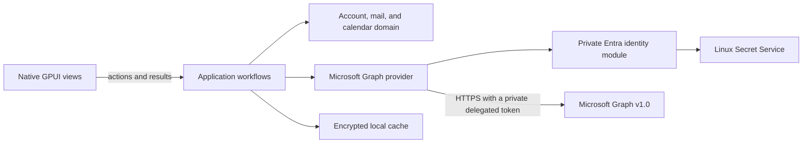

# System architecture

## Runtime shape

The application uses GPUI Kit for its native interface. Rust owns the UI, mail and calendar workflows, provider access, persistence, synchronization, and Linux operating-system integration. It does not use the Tauri runtime or a browser frontend.

PR #47 contains the M2 read-only mail candidate. The M3 branch `candidate/issue-22-calendar-sync` adds a Linux-only, read-only weekly agenda on the same account session and encrypted cache. M4 adds explicit read-state updates, follow-up flags, plain-text sends, replies to cached messages, message moves, and a Delete action that moves mail into Deleted Items. ADRs [0015](../decisions/0015-idempotent-message-read-state-update.md), [0017](../decisions/0017-safe-plain-text-mail-sending.md), [0018](../decisions/0018-native-plain-text-message-reply.md), [0019](../decisions/0019-follow-up-flags-on-cached-messages.md), [0020](../decisions/0020-move-cached-messages-between-folders.md), and [0039](../decisions/0039-move-messages-to-deleted-items.md) record these actions.

## Module ownership

| Path | Owns | Must not own |
| --- | --- | --- |
| `apps/desktop/` | GPUI lifecycle, native views, keyboard actions, the Linux process lock, OS integration, and sanitized email rendering | Mail rules, Graph requests, database schema |
| `crates/application/` | Account, mail, and calendar workflows, provider/cache ports, mail and calendar actions, application errors, and email sanitization | GPUI, Graph JSON, concrete database types |
| `crates/domain/` | Provider-independent account, folder, message, calendar occurrence, and sync invariants | Framework and provider details |
| `crates/providers/microsoft-graph/` | Linux OAuth, Graph profile/folder/message/calendar-view and event requests, explicitly authorized mail and calendar writes, response mapping, private HTTP transport, and refresh-token storage | UI decisions, persistence policy, token access in application code |
| `crates/persistence/` | Linux XDG paths, Secret Service key references, SQLCipher schema and migrations, encrypted records, atomic mail/calendar sync and event/message updates, durable send/reply recovery markers, and cache removal | Graph or GPUI types |

The dependency direction is desktop UI → application → domain, with Graph and persistence adapters implementing application-owned ports. Views never call Graph or access the database directly.

## Data flow

1. A GPUI view calls an application workflow to list cached folders/messages, synchronize mail, open a message, or load a calendar week.
2. The account session composes focused mail and calendar sessions over the same account cache and provider. Calendar views use the application session for reads, synchronization, event creation, editing, deletion, and recovery. Graph OAuth tokens remain private to the provider.
3. The Graph adapter validates and maps external responses into provider-independent values. It follows opaque next links through the private transport worker.
4. The mail workflow applies the account's fixed 90-day cutoff and persists each page with its matching cursor update in one SQLCipher transaction. A folder becomes synchronized only after its complete page chain and final delta link commit.
5. Opening a message returns an encrypted cached body when available. Otherwise, the workflow reserves the folder against account sync, rereads the message, fetches its body, and stores the raw form for offline reading.
6. The application sanitizes raw HTML whenever it prepares a body for display and returns an opaque `SanitizedEmailHtml`. Sanitized output is not persisted.
7. The desktop renders only that sanitized value through GPUI Kit `TextView::html`; oversized sanitized content becomes bounded, escaped plain text.
8. The calendar workflow requests bounded Graph `calendarView/delta` pages for the fixed UTC bounds of the selected Linux week. Each page and range cursor commit together, while cached events remain available when a request fails. The agenda uses Jiff only to display timed instants in the Linux system zone; all-day dates remain unchanged.
9. Event creation saves one exact timed draft and stable transaction ID in SQLCipher before a single Graph POST. The cache records definitive rejection before clearing its marker. Unknown outcomes retain the same operation for recovery; account removal remains blocked while its outcome is unresolved. See [ADR 0016](../decisions/0016-idempotent-primary-calendar-event-creation.md).
10. Editing first reads the current Graph event and permits only timed, standalone appointments with no attendees or online meeting. Before PATCH, the provider reads it again and compares its `changeKey`; it sends only changed subject and start/end fields, requires matching `200 OK` values, then atomically reconciles all cached ranges. Graph's v1.0 OpenAPI does not document `If-Match` for PATCH, so a narrow final-read-to-write race remains. See [ADR 0023](../decisions/0023-edit-standalone-calendar-appointments.md).
11. Deletion requires explicit native confirmation, then repeats the event eligibility and version check. The provider sends one `DELETE` with the final read's `@odata.etag` in `If-Match` and accepts only `204 No Content`. SQLCipher removes every cached copy atomically without moving view cursors. An uncertain result or cache failure requires successful calendar sync before another write. The Learn page omits `If-Match`, although the maintained v1.0 OpenAPI declares it for DELETE; tenant behavior remains unverified. See [ADR 0026](../decisions/0026-delete-standalone-calendar-appointments.md).
12. A read-state or follow-up flag action reserves the cached folder, stages a shared account-and-folder recovery marker in SQLCipher, sends one PATCH with only the requested property, and waits for Graph's `200 OK` response with the matching value before updating the cache. A complete folder delta round clears the marker after an unknown outcome or app exit. Permission renewal explains `Mail.ReadWrite`'s full scope, verifies the same account, and preserves the current session and cache if consent fails. These actions never queue offline or retry automatically; see [ADR 0015](../decisions/0015-idempotent-message-read-state-update.md) and [ADR 0019](../decisions/0019-follow-up-flags-on-cached-messages.md).
13. A message move verifies that the cached source and visible destination belong to the same account, then reserves both folders. The Graph adapter sends one non-retried move request and requires the same immutable message ID and destination folder in its response. SQLCipher moves the cached row and body in one transaction. Account synchronization reserves the account before replacing the visible folder tree. See [ADR 0020](../decisions/0020-move-cached-messages-between-folders.md).
14. The native Delete action resolves the locale-independent Deleted Items folder through Graph's `deleteditems` well-known name, verifies its returned ID is in the active account's visible folder tree, then uses the message-move workflow. It preserves the encrypted body, rejects a source already in Deleted Items, and requires a successful account sync before another move attempt after an uncertain result. See [ADR 0039](../decisions/0039-move-messages-to-deleted-items.md).
15. A new-message send or reply reserves the account and saves one body-free SQLCipher marker before its Graph POST. A reply keeps the cached source folder and message IDs with an optional subject; Graph selects the reply recipients. The app does not retry an uncertain POST. It keeps the marker until the user checks Sent Items and resolves it. Account removal and another send remain blocked while the marker exists. See [ADR 0017](../decisions/0017-safe-plain-text-mail-sending.md) and [ADR 0018](../decisions/0018-native-plain-text-message-reply.md).
16. Account removal holds the shared account reservation while it checks pending send and unresolved event-creation markers and removes the cache. AccountView keeps the account session when the user returns from Mail or Calendar, then reuses its cache worker on sign-out or when the user reopens a view. The Linux desktop acquires a per-user process lock before GPUI starts. See [ADR 0027](../decisions/0027-serialize-mail-account-removal-with-mail-operations.md) and [ADR 0028](../decisions/0028-single-linux-desktop-process.md).

## Synchronization rules

- Enumerate visible, non-hidden folders for the signed-in account. Keep folders, messages, and cursors scoped to that account and folder.
- Start each folder with an unfiltered message-delta round, follow every page, then apply the fixed 90-day cutoff locally. This avoids Graph's 5,000-result cap for filtered delta responses.
- Follow `@odata.nextLink` and `@odata.deltaLink` as opaque values. Before attaching a bearer token, require HTTPS and the configured Graph authority. Disable redirects for authorized requests.
- Send `Content-Type: application/json` on initial and continuation message-delta and calendar-view-delta GETs, as required by Microsoft Graph v1.0.
- Scope each calendar cursor to the signed-in account and exact UTC view bounds. Graph expands recurrences; preserve source-zone IDs as opaque metadata. Do not set a response-time-zone preference.
- Commit each calendar page and its range cursor atomically. Apply sparse changes only to cached occurrences and remove records that no longer overlap the fixed view.
- Use Jiff at the Linux desktop boundary to format timed instants. Display all-day half-open date ranges as dates without time-zone conversion.
- Commit each page and its restart checkpoint atomically. Keep each attempt within 1,000 pages and 64 MiB of response data per folder.
- Share account, mail-folder, and calendar-view reservations among sessions from one workflow factory. Account-level sync, send, and removal fail with an active-operation result while folder or calendar-view work is in flight. Acquire account reservations before listing or replacing folders and hold them through delta sync. Persist a checkpoint revision and accept a page or reset only when its request started from the current revision.
- Permit event updates and deletions only after a successful sync of the source view in the current workflow. After a stale event, uncertain write, or confirmed write that cannot be cached, require each previously synchronized account view to sync successfully before another event write. Do not retry uncertain writes.
- Keep the account session and its cache client alive across Mail and Calendar view transitions. On sign-out, reuse that session for cache removal so a second database worker cannot overtake queued work. Use the factory removal path only when no account session has been opened. See [ADR 0027](../decisions/0027-serialize-mail-account-removal-with-mail-operations.md).
- If Graph returns `410 Gone` for a message delta request, validate its reset URL and start a durable replacement generation. Keep unseen rows and their bodies until the final replacement page commits. A replacement upsert clears that message's cached body in the page transaction; completion deletes unseen rows and clears bodies for all retained rows atomically with the final cursor. See [ADR 0032](../decisions/0032-recover-expired-message-delta-cursors.md) and [ADR 0034](../decisions/0034-invalidate-cached-message-bodies-after-delta-updates.md).
- Apply removals and sparse metadata patches only to messages already in the local scope. Preserve fields omitted from a sparse patch and distinguish explicit nulls for nullable fields.
- Fetch bodies only after the user opens a message. Do not download attachments in M2.
- Keep the M2 mail candidate read-only. M4 adds explicit event create/edit/delete actions, message read-state and follow-up flag changes, plain-text sends, replies, and message moves. Other mail actions remain separate.

Synthetic Graph, workflow, persistence, and headless GPUI tests cover mail and calendar paging, cache checkpoints, offline reads, and renderer and agenda behavior. They do not prove live mailbox completeness or calendar recurrence and all-day semantics; see issues #3, #6, and #8. Issue #22 remains open for manual screen-reader, focus, scrolling, and layout review.

## Security boundaries

- Parse and validate Graph responses and stored data at their boundaries. Never include tokens, message bodies, addresses, or full Graph URLs in logs or fixtures.
- Keep OAuth tokens out of views, application ports, SQLite rows, and message content. Store the refresh token in Linux Secret Service.
- Treat message HTML as untrusted. Ammonia applies the allowlist in `crates/application`. Remote images, scripts, styles, frames, and other active content are removed. The view revalidates links when activated and supplies a non-networking image resolver.
- Keep the main interface native GPUI. A browser engine for email would require a separate security decision and must remain a body-only leaf without app commands, tokens, IPC, or mailbox access.
- Store cache files under the Linux XDG data home with private permissions. Encrypt them with SQLCipher and keep the cache key in Secret Service. Never replace a missing key automatically.
- During account removal, close the SQLCipher client, remove the `-wal` and `-shm` sidecars, then remove the main database. Keep the cache key and provider refresh token when cache-file removal fails; the desktop asks the provider to sign out only after cache removal succeeds. See [ADR 0029](../decisions/0029-retry-cache-removal-after-sidecar-failure.md).
- Before GPUI starts, hold `XDG_DATA_HOME/einfach-mail/instance.lock` with `std::fs::File::try_lock`. Keep the lock file after exit. See [ADR 0028](../decisions/0028-single-linux-desktop-process.md).

## Design risks

- No dedicated Microsoft 365 test tenant or public app registration is available. Live Entra behavior, complete Graph mailbox sync, Mail.ReadWrite consent, and read-state and follow-up flag PATCH behavior remain unverified under issues #3, #8, #24, and #32.
- Issue #9 remains open for real-window layout, operating-system clipboard behavior, and system-browser launch. Headless GPUI tests do not establish those behaviors.
- Calendar recurrence, daylight-saving boundaries, and all-day semantics have synthetic coverage only. Keep issue #6 open for tenant verification; keep issue #22 open for manual Linux accessibility and layout review.
- Reply recipient routing and Sent Items reconciliation have synthetic coverage only. Keep issue #30 open for tenant verification.
- GPUI Kit is pre-1.0. Windows and macOS builds and runtime checks are deferred until those platforms enter scope.
