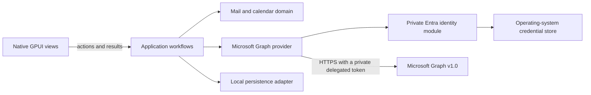

# System architecture

## Runtime shape

The app uses GPUI Kit for its native desktop UI. Rust owns the application, provider access, persistence, synchronization, and operating-system integration. The app does not use the Tauri runtime or a browser frontend.

The diagram shows planned behavior. The workspace currently contains a desktop shell, an application crate with no workflows yet, a domain crate with opaque identifier types, and a test-only storage proof package. Provider, production persistence, and mail/calendar workflows are not implemented yet.

## Module ownership

| Path | Owns | Must not own |
| --- | --- | --- |
| `apps/desktop/` | GPUI lifecycle, native views, keyboard actions, OS integration, and native rendering of `SanitizedEmailHtml` | Mail rules, Graph request construction, database schema |
| `crates/application/` | User workflows, orchestration, ports, application errors, and the product-specific sanitizer that produces `SanitizedEmailHtml` | GPUI, Graph JSON, concrete database types |
| `crates/domain/` | Account, folder, message, calendar, event, and sync invariants | Framework and provider details |
| `crates/providers/microsoft-graph/` (planned) | Graph HTTP transport, pagination, throttling, API response parsing, domain mapping, and private Entra identity/token handling | UI decisions, persistence policy, and token access in application code |
| `crates/persistence/` (planned) | Local schema, migrations, transactions, durable sync state | Graph or GPUI types |

This table describes the intended ownership boundaries; it does not imply that every listed component exists yet. Update [project status](../project/status.md) when implementation changes.

Add planned crates when a change needs them. Do not create forwarding-only layers.

## Data flow

1. A GPUI view calls an application workflow.
2. The workflow calls a provider-neutral account, mail, or calendar port.
3. The Microsoft provider's private identity module acquires or refreshes a token. The token stays in the provider and is used only for the Graph request.
4. The provider parses Graph responses into domain values. A persistence adapter commits related data changes and sync progress in one transaction.
5. The application sanitizes a message body for display into `SanitizedEmailHtml`; the desktop renders it with GPUI Kit `TextView::html`.
6. The view renders loading, success, offline, and failure states from application results.

OAuth tokens do not cross application ports. Views never receive tokens, call Graph, access identity state, or open the local database. The private identity module and Graph HTTP client are planned inside `crates/providers/microsoft-graph/`; see [ADR 0008](../decisions/0008-identity-token-boundary.md).

Domain entity IDs are opaque provider values and are always scoped by account. Preserve their exact case and contents. The Graph adapter requests immutable Outlook item IDs where supported; see [ADR 0009](../decisions/0009-account-scoped-domain-identifiers.md).

## Synchronization rules

- Use Microsoft Graph v1.0 delta queries for mail folders and calendar views where supported.
- Treat `@odata.nextLink` and `@odata.deltaLink` as opaque provider values. Follow the complete next-link chain before advancing a sync cursor.
- Before sending a bearer token to a next link, verify HTTPS and the configured Graph authority. Disable redirects for authorized Graph requests.
- Commit page changes and cursor state atomically. A restart or retry must not skip changes or duplicate visible records.
- Keep cursor state scoped to the account and the exact Graph collection or calendar-view range that created it.
- Use an outbox for local actions that may retry. Give each action a stable local identity and represent pending, confirmed, and failed states explicitly.
- Respect Graph throttling and retry guidance. Do not loop on authorization or validation failures.
- Honor Graph's `Retry-After` header after HTTP 429. Use exponential backoff only when the response has no retry header. Do not retry a write until duplicate-request behavior is known.

These are design constraints, not implemented behavior yet.

## Security boundaries

- Parse Graph responses, configuration, and stored data at their boundaries.
- Treat message HTML as untrusted input. The application must sanitize it with a maintained library before it reaches a view, and expose only `SanitizedEmailHtml` to the desktop. Never persist the sanitized result.
- The proposed first renderer is GPUI Kit `TextView::html`. Keep scripts, styles, images, and other remote content blocked by default; override link routing and image resolution as defense in depth.
- Keep the app UI in GPUI. A browser renderer for email HTML needs a separate security decision and must be limited to the message body. Give message content no application commands, tokens, IPC bridge, or access to mailbox data.
- Store refresh credentials in the operating-system credential store. Do not persist access tokens in SQLite or UI state.
- Decide local database encryption and key recovery before the app stores real mailbox content.

## Design risks

- Microsoft Graph does not support Exchange Server installed on premises. Supporting it needs a separate provider design.
- Microsoft does not list an official Rust MSAL implementation in its desktop app library table. Authentication needs a tested implementation choice before account sign-in ships.
- GPUI Kit is pre-1.0. Keep its resolved dependency graph in `Cargo.lock` and check the app on each supported platform.
- GPUI Kit's optional WebView package is experimental. Linux embedding requires X11 or XWayland, not Wayland. Windows WebView bounds cover GPUI overlays. It is not part of the proposed first message renderer; see [ADR 0007](../decisions/0007-message-body-rendering.md).
- Delta sync, recurring events, shared mailboxes, attachments, and calendar time zones have provider-specific behavior. Add a focused contract check for each supported behavior.
- The proposed Graph transport is `reqwest`, but its async client requires Tokio while the current GPUI dependency graph uses `smol`. Keep that runtime boundary inside the provider and prove it before adding the dependency.
- The current `io-msgraph` release includes calendar calls in its changelog, but its published README is stale and its error type drops `Retry-After`. See [ADR 0006](../decisions/0006-graph-http-transport.md) for the candidate review.
