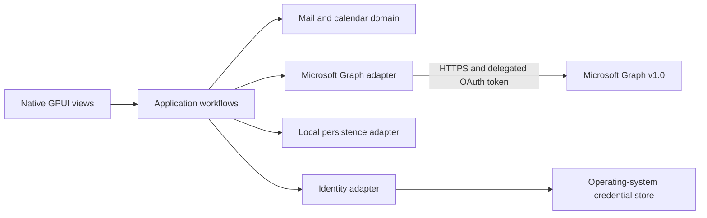

# System architecture

## Runtime shape

The app uses GPUI Kit for its native desktop UI. Rust owns the application, provider access, persistence, synchronization, and operating-system integration. The app does not use a browser frontend.

The diagram shows planned components. The workspace currently contains the desktop shell, domain crate, and application crate.

## Module ownership

| Path | Owns | Must not own |
| --- | --- | --- |
| `apps/desktop/` | GPUI lifecycle, native views, keyboard actions, and OS integration | Mail rules, Graph request construction, database schema |
| `crates/application/` | User workflows, orchestration, ports, application errors | GPUI, Graph JSON, concrete database types |
| `crates/domain/` | Account, folder, message, calendar, event, and sync invariants | Framework and provider details |
| `crates/providers/microsoft-graph/` (planned) | OAuth and Graph HTTP translation, pagination, throttling, API DTO parsing | UI decisions and persistence policy |
| `crates/persistence/` (planned) | Local schema, migrations, transactions, durable sync state | Graph or GPUI types |
| Email body renderer (planned) | Sanitizing message HTML and rendering safe content | App commands, tokens, mailbox access |

Add planned crates when a change needs them. Do not create forwarding-only layers.

## Data flow

1. A GPUI view calls an application workflow.
2. The workflow reads or changes domain state through application ports.
3. A provider adapter parses Graph responses into domain values. A persistence adapter commits related data changes and sync progress in one transaction.
4. The view renders loading, success, offline, and failure states from application results.

Views never receive OAuth tokens. They never call Graph or open the local database.

## Synchronization rules

- Use Microsoft Graph v1.0 delta queries for mail folders and calendar views where supported.
- Treat `@odata.nextLink` and `@odata.deltaLink` as opaque provider values. Follow the complete next-link chain before advancing a sync cursor.
- Commit page changes and cursor state atomically. A restart or retry must not skip changes or duplicate visible records.
- Keep cursor state scoped to the account and the exact Graph collection or calendar-view range that created it.
- Use an outbox for local actions that may retry. Give each action a stable local identity and represent pending, confirmed, and failed states explicitly.
- Respect Graph throttling and retry guidance. Do not loop on authorization or validation failures.

These are design constraints, not implemented behavior yet.

## Security boundaries

- Parse Graph responses, configuration, and stored data at their boundaries.
- Treat message HTML as untrusted input. Find and use a maintained parser or sanitizer before rendering it. Keep remote images, scripts, and other remote content blocked by default.
- Keep the app UI in GPUI. If a browser renderer is needed for email HTML, isolate it to the message body. Give message content no application commands, tokens, or access to mailbox data.
- Store refresh credentials in the operating-system credential store. Do not persist access tokens in SQLite or UI state.
- Decide local database encryption and key recovery before the app stores real mailbox content.

## Design risks

- Microsoft Graph does not support Exchange Server installed on premises. Supporting it needs a separate provider design.
- Microsoft does not list an official Rust MSAL implementation in its desktop app library table. Authentication needs a tested implementation choice before account sign-in ships.
- GPUI Kit is pre-1.0. Keep its resolved dependency graph in `Cargo.lock` and check the app on each supported platform.
- GPUI Kit's optional WebView package is experimental. Linux embedding requires X11 or XWayland, not Wayland. Windows WebView bounds cover GPUI overlays. The current shell does not depend on that package.
- Delta sync, recurring events, shared mailboxes, attachments, and calendar time zones have provider-specific behavior. Add a focused contract check for each supported behavior.
