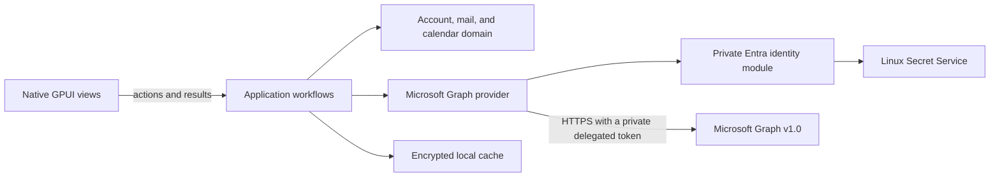

# System architecture

## Runtime shape

The application uses GPUI Kit for its native interface. Rust owns the UI, mail and calendar workflows, provider access, persistence, synchronization, and Linux operating-system integration. It does not use the Tauri runtime or a browser frontend.

PR #47 contains the M2 read-only mail candidate. The M3 branch `candidate/issue-22-calendar-sync` adds a Linux-only, read-only weekly agenda on the same account session and encrypted cache. Server-side mail and calendar actions remain outside M3.

## Module ownership

| Path | Owns | Must not own |
| --- | --- | --- |
| `apps/desktop/` | GPUI lifecycle, native views, keyboard actions, OS integration, and sanitized email rendering | Mail rules, Graph requests, database schema |
| `crates/application/` | Account, mail, and calendar workflows, provider/cache ports, application errors, and email sanitization | GPUI, Graph JSON, concrete database types |
| `crates/domain/` | Provider-independent account, folder, message, calendar occurrence, and sync invariants | Framework and provider details |
| `crates/providers/microsoft-graph/` | Linux OAuth, Graph profile/folder/message/calendar-view requests, response mapping, private HTTP transport, and refresh-token storage | UI decisions, persistence policy, token access in application code |
| `crates/persistence/` | Linux XDG paths, Secret Service key references, SQLCipher schema and migrations, encrypted records, atomic mail/calendar sync, and cache removal | Graph or GPUI types |

The dependency direction is desktop UI → application → domain, with Graph and persistence adapters implementing application-owned ports. Views never call Graph or access the database directly.

## Data flow

1. A GPUI view calls an application workflow to list cached folders/messages, synchronize mail, open a message, or load a calendar week.
2. The account session composes focused mail and calendar sessions over the same account cache and provider. Graph OAuth tokens remain private to the provider.
3. The Graph adapter validates and maps external responses into provider-independent values. It follows opaque next links through the private transport worker.
4. The mail workflow applies the account's fixed 90-day cutoff and persists each page with its matching cursor update in one SQLCipher transaction. A folder becomes synchronized only after its complete page chain and final delta link commit.
5. Opening a message returns an encrypted cached body when available. Otherwise, the workflow reserves the folder against account sync, rereads the message, fetches its body, and stores the raw form for offline reading.
6. The application sanitizes raw HTML whenever it prepares a body for display and returns an opaque `SanitizedEmailHtml`. Sanitized output is not persisted.
7. The desktop renders only that sanitized value through GPUI Kit `TextView::html`; oversized sanitized content becomes bounded, escaped plain text.
8. The calendar workflow requests bounded Graph `calendarView/delta` pages for the fixed UTC bounds of the selected Linux week. Each page and range cursor commit together, while cached events remain available when a request fails. The agenda uses Jiff only to display timed instants in the Linux system zone; all-day dates remain unchanged.

## Synchronization rules

- Enumerate visible, non-hidden folders for the signed-in account. Keep folders, messages, and cursors scoped to that account and folder.
- Start each folder with an unfiltered message-delta round, follow every page, then apply the fixed 90-day cutoff locally. This avoids Graph's 5,000-result cap for filtered delta responses.
- Follow `@odata.nextLink` and `@odata.deltaLink` as opaque values. Before attaching a bearer token, require HTTPS and the configured Graph authority. Disable redirects for authorized requests.
- Send `Content-Type: application/json` on initial and continuation message-delta and calendar-view-delta GETs, as required by Microsoft Graph v1.0.
- Scope each calendar cursor to the signed-in account and exact UTC view bounds. Graph expands recurrences; preserve source-zone IDs as opaque metadata. Do not set a response-time-zone preference.
- Commit each calendar page and its range cursor atomically. Apply sparse changes only to cached occurrences and remove records that no longer overlap the fixed view.
- Use Jiff at the Linux desktop boundary to format timed instants. Display all-day half-open date ranges as dates without time-zone conversion.
- Commit each page and its restart checkpoint atomically. Keep each attempt within 1,000 pages and 64 MiB of response data per folder.
- Share account and folder reservations among sessions from one workflow factory. Acquire the account reservation before listing or replacing folders and hold it through delta sync. Persist a checkpoint revision and accept a page or reset only when its request started from the current revision.
- If Graph returns `410 Gone` for a message delta request, validate its reset URL and start a durable replacement generation. Keep unseen rows and their bodies until the final replacement page commits. A replacement upsert clears that message's cached body in the page transaction; completion deletes unseen rows and clears bodies for all retained rows atomically with the final cursor. See [ADR 0032](../decisions/0032-recover-expired-message-delta-cursors.md) and [ADR 0034](../decisions/0034-invalidate-cached-message-bodies-after-delta-updates.md).
- Apply removals and sparse metadata patches only to messages already in the local scope. Preserve fields omitted from a sparse patch and distinguish explicit nulls for nullable fields.
- Fetch bodies only after the user opens a message. Do not download attachments in M2.
- Keep M2 read-only: the app does not mark messages read, move, archive, flag, delete, or send them on the server.

Synthetic Graph, workflow, persistence, and headless GPUI tests cover mail and calendar paging, cache checkpoints, offline reads, and renderer and agenda behavior. They do not prove live mailbox completeness or calendar recurrence and all-day semantics; see issues #3, #6, and #8. Issue #22 remains open for manual screen-reader, focus, scrolling, and layout review.

## Security boundaries

- Parse and validate Graph responses and stored data at their boundaries. Never include tokens, message bodies, addresses, or full Graph URLs in logs or fixtures.
- Keep OAuth tokens out of views, application ports, SQLite rows, and message content. Store the refresh token in Linux Secret Service.
- Treat message HTML as untrusted. Ammonia applies the allowlist in `crates/application`. Remote images, scripts, styles, frames, and other active content are removed. The view revalidates links when activated and supplies a non-networking image resolver.
- Keep the main interface native GPUI. A browser engine for email would require a separate security decision and must remain a body-only leaf without app commands, tokens, IPC, or mailbox access.
- Store cache files under the Linux XDG data home with private permissions. Encrypt them with SQLCipher and keep the cache key in Secret Service. Never replace a missing key automatically.
- The persistence adapter holds a shared per-account lock for each open cache handle, so multiple sessions can use the cache together. A separate short-lived exclusive lock serializes key setup and schema migration. No-open removal and removal through a live handle require an exclusive lifetime lock; they return an in-use error before changing files or credentials while another cache session remains open. Removal closes SQLCipher, removes the `-wal` and `-shm` sidecars, then removes the main database and key under the exclusive lock. Keep the provider refresh token when cache removal fails; the desktop asks the provider to sign out only after cache removal succeeds. See [ADR 0029](../decisions/0029-retry-cache-removal-after-sidecar-failure.md).

## Design risks

- No dedicated Microsoft 365 test tenant or public app registration is available. Live Entra behavior and complete Graph mailbox sync remain unverified under issues #3 and #8.
- Issue #9 remains open for real-window layout, operating-system clipboard behavior, and system-browser launch. Headless GPUI tests do not establish those behaviors.
- Calendar recurrence, daylight-saving boundaries, and all-day semantics have synthetic coverage only. Keep issue #6 open for tenant verification; keep issue #22 open for manual Linux accessibility and layout review.
- GPUI Kit is pre-1.0. Windows and macOS builds and runtime checks are deferred until those platforms enter scope.
